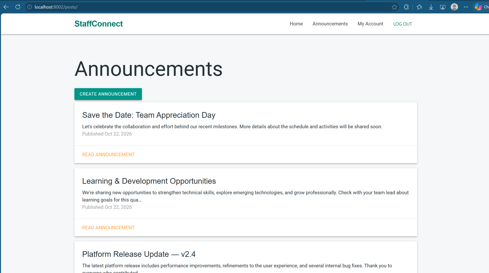
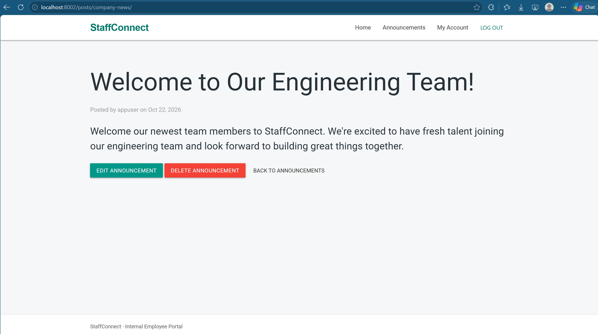
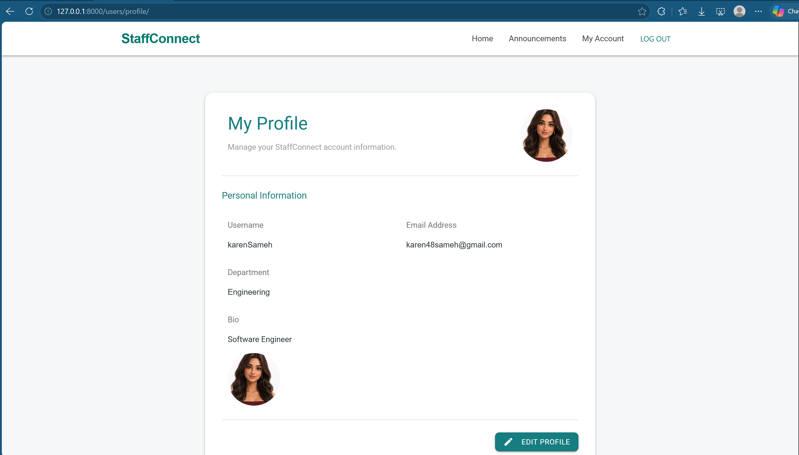
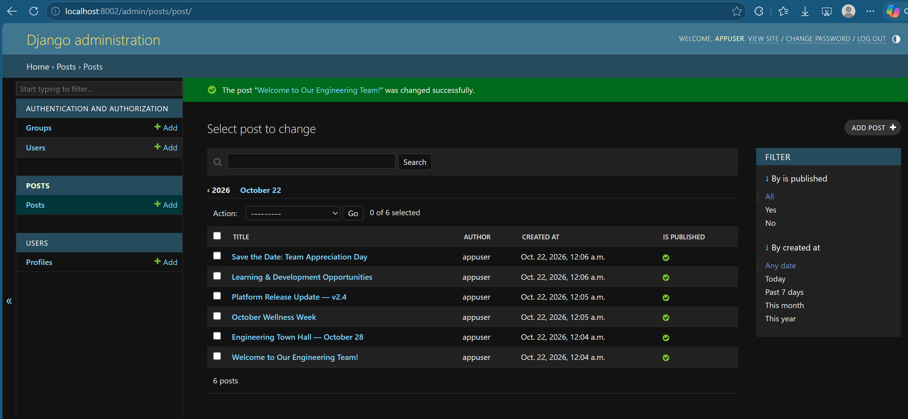
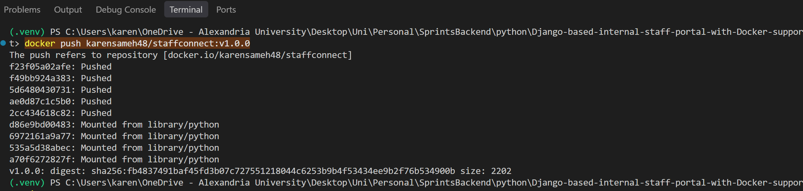
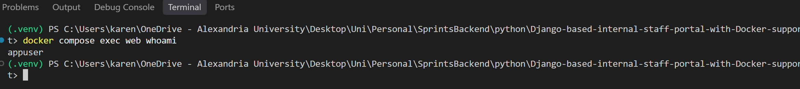

# StaffConnect — Internal Staff Portal

StaffConnect is a Django-based internal staff portal designed to help organizations manage employee profiles and share internal announcements. It includes authentication, profile management, announcement CRUD operations, pagination, and Docker deployment.

## Features

### User Management
- User registration, login, and logout
- Password reset functionality
- Employee profile management and photo uploads
- Django authentication and permission controls

### Announcements
- Create, view, edit, and delete announcements
- Restrict editing and deletion to the announcement's author
- Public display of published announcements
- Paginated announcement lists
- Announcement detail pages using URL slugs

### Administration
- Django Admin integration
- Superuser access for administrative tasks

### Docker
- Dockerized Django application
- Non-root application user (`appuser`)
- Persistent Docker volumes for database and uploaded media
- Public Docker Hub image

## Technology Stack

- **Backend:** Python, Django
- **Database:** SQLite
- **Frontend:** HTML, CSS, Materialize CSS, Django Templates
- **Containerization:** Docker, Docker Compose
- **Version Control:** Git and GitHub

## Getting Started

### Prerequisites
- Docker Desktop with Docker Compose, or Python 3.11 and pip for local development

### Run with Docker Compose

1. Clone the repository:

   ```bash
   git clone https://github.com/KarenSamehS/Django-based-internal-staff-portal-with-Docker-support.git
   cd Django-based-internal-staff-portal-with-Docker-support
   ```

2. Create the `.env` file with the environment variables expected by your Django settings. Do not commit secrets to version control.

3. Build and start the application:

   ```bash
   docker compose up -d --build
   ```

4. Apply database migrations:

   ```bash
   docker compose exec web python manage.py migrate
   ```

5. Create an administrator account if needed:

   ```bash
   docker compose exec web python manage.py createsuperuser
   ```

6. Open the application:
   - **StaffConnect:** http://localhost:8000/
   - **Django Admin:** http://localhost:8000/admin/

### Run the Published Docker Image

Pull the published image:

```bash
docker pull karensameh48/staffconnect:v1.0.0
```

- **Docker Hub:** https://hub.docker.com/r/karensameh48/staffconnect
- **Image:** `karensameh48/staffconnect:v1.0.0`

For standalone deployment, configure the required environment variables, persistent storage, and database migrations before starting the application.

## Docker Configuration

The Docker Compose configuration runs the application and uses persistent volumes for the database and uploaded media.

Useful commands:

```bash
docker compose up -d
docker compose up -d --build
docker compose ps
docker compose logs web
docker compose exec web whoami
docker compose down
```

The non-root verification command should return:

```text
appuser
```

## Project Structure

```text
.
├── config/
├── posts/
├── users/
├── templates/
├── Dockerfile
├── docker-compose.yml
├── .dockerignore
├── requirements.txt
├── manage.py
└── README.md
```

## Security and Data Persistence

- Authentication uses Django's authentication framework.
- Announcement editing and deletion are restricted to authorized users.
- The Docker application runs as a non-root user.
- Database and uploaded media persistence are configured through Docker volumes.
- Environment files and local database files should remain excluded from version control.

## Screenshots

### Application

**Homepage — Announcement List**



**Announcement Detail Page**



**Employee Profile**



**Django Admin Dashboard**



### Docker Deployment and Security

**Docker Image Push**



Published image: `karensameh48/staffconnect:v1.0.0`

[View the Docker Hub repository](https://hub.docker.com/r/karensameh48/staffconnect)

**Non-Root Container Verification**



The application container runs as the non-root user `appuser`.

## Repository

- **GitHub:** https://github.com/KarenSamehS/Django-based-internal-staff-portal-with-Docker-support
- **Docker Hub:** https://hub.docker.com/r/karensameh48/staffconnect

